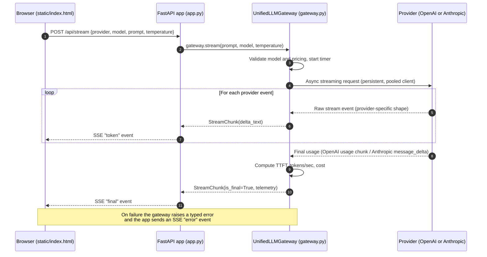

# Multi-Provider LLM Gateway

An asynchronous, streaming gateway that puts OpenAI and Anthropic models behind one interface, `UnifiedLLMGateway.stream()`. Every response is streamed as normalized `StreamChunk` objects, and the final chunk carries telemetry: input and output tokens, total latency, time-to-first-token (TTFT), tokens per second and cost in USD.

A small FastAPI web UI streams responses over Server-Sent Events (SSE) so you can compare providers side by side.

**Main pieces**

| File | Role |
|---|---|
| `gateway.py` | `UnifiedLLMGateway`: persistent async clients, provider adapters, telemetry, typed error translation |
| `schemas.py` | Pydantic v2 models (`StreamChunk`, `ChunkTelemetry`) and the exception hierarchy |
| `pricing.py` | Pricing table and cost calculation |
| `app.py` | FastAPI app: `GET /`, `GET /api/models`, `POST /api/stream` (SSE) |
| `static/index.html` | Browser UI |
| `tests/` | pytest suite (unit, real-dependency and static tests, plus one opt-in live test) |
| `ai_prompt_log.md` | The original AI prompt and the audit of its first draft |

## 1. Architecture



**How it fits together**
- The two provider adapters (`_openai_deltas`, `_anthropic_deltas`) hide the different stream formats, so the consumer only ever sees `StreamChunk`.
- Both SDK clients (`AsyncOpenAI`, `AsyncAnthropic`) are created once in `UnifiedLLMGateway.__init__` and reused, so HTTP connections are pooled.
- TTFT is measured from just before the provider request is sent to the first non-empty text delta.
- Errors become typed domain exceptions (`RateLimitExceededError`, `AuthenticationFailedError`, `ProviderConnectionError`, `GatewayProviderError`) with fixed, secret-free messages.

## 2. Environment and prerequisites

- **Python 3.11 or newer** (`requires-python = ">=3.11"`)
- **[uv](https://docs.astral.sh/uv/)** for dependency management
- Optional: **Docker Desktop** to run the container

Install the dependencies (from the project folder):

```bash
uv sync
```

`uv sync` creates `.venv` and installs the runtime and dev dependencies from `pyproject.toml` and `uv.lock`.

## 3. Configuration and security

```bash
# macOS / Linux
cp .env.example .env

# Windows PowerShell
Copy-Item .env.example .env
```

Open `.env` and fill in your keys:

```
OPENAI_API_KEY=your-openai-key
ANTHROPIC_API_KEY=your-anthropic-key
```

Security notes:
- `.env` is listed in `.gitignore` and `.dockerignore`. **Never commit it or share it.** `.env.example` contains only blank placeholders.
- Keys are read only on the server from environment variables. They are never sent to the browser and never baked into the Docker image.
- Error messages contain only a fixed description, the HTTP status and the request id. Raw SDK messages are never forwarded, and logs have no stack traces.
- If a key is ever exposed, revoke it in the provider dashboard and create a new one.

The app reads keys from the process environment (it does not load `.env` by itself), so the commands below pass the file explicitly.

## 4. Running the project

**Web interface (local)**

```bash
uv run --env-file .env uvicorn app:app --reload
```

Then open <http://127.0.0.1:8000>, choose a provider and model, enter a prompt and press Send.

**Test harness**

```bash
uv run pytest -v
```

Expected result: all tests pass, and one test is skipped (the opt-in live OpenAI test). Optional live test against the real OpenAI API (this spends a small amount of credit):

```bash
# Windows PowerShell
$env:RUN_LIVE_TESTS = "1"; uv run --env-file .env pytest -v -m live
```

**Docker (optional)**

```bash
docker compose up --build
```

The container serves the same UI on <http://localhost:8000> and reads the keys from your `.env` (or shell environment). Stop it with `docker compose down`.

## 5. Pricing matrix

Rates used for cost telemetry, in USD per 1,000,000 tokens (`pricing.py`). Cost = `input_tokens × input_rate / 1,000,000 + output_tokens × output_rate / 1,000,000`.

| Provider | Model | Input (USD / 1M tokens) | Output (USD / 1M tokens) |
|---|---|---:|---:|
| OpenAI | `gpt-4o-mini` | 0.15 | 0.60 |
| OpenAI | `gpt-4o` | 2.50 | 10.00 |
| Anthropic | `claude-haiku-5-5` | 0.10 | 0.50 |
| Anthropic | `claude-sonnet-5-5` | 2.00 | 10.00 |

These rates are a manually maintained snapshot and can go out of date. The Haiku rate is approximate (the provider lists it as a "from" price), so check the providers' pricing pages before relying on the numbers. Unknown model names raise `UnsupportedModelError`.

## 6. Audit and verification summary

The first AI-generated draft was audited line by line against the Step 3 checklist (the full record is in [`ai_prompt_log.md`](ai_prompt_log.md)).

**Checklist items that passed review**
- **Event-loop blocking:** only async clients; tiktoken work already runs in `asyncio.to_thread`.
- **OpenAI delta parsing:** `if chunk.usage is not None`, `if chunk.choices` and `if text` correctly handle the final usage chunk with empty `choices` and `delta.content is None`.
- **Client instantiation:** clients are created once on the gateway instance, not per call.

**Discrepancies between the initial AI output and the final code**

| # | Issue in first draft | Final code | Status |
|---|---|---|---|
| 1 | **Timing drift:** the TTFT and latency clock started before the local tiktoken estimate, so OpenAI TTFT included our own overhead (and a one-time encoding download) | `state.t0` is reset immediately before the provider request; test `test_openai_timing_excludes_local_tokenizer_work` | Fixed |
| 2 | **Anthropic `temperature`:** sent as a keyword the current SDK removed (TypeError), then rejected by the live API with HTTP 400 for Claude 5.x models | Temperature is not sent to Anthropic; the range check stays for a uniform interface | Fixed |
| 3 | **Retired model names** (`claude-3-5-*`) caused HTTP 404 | Switched to `claude-sonnet-5-5` and `claude-haiku-5-5` in the pricing table and model catalog | Fixed |
| 4 | **Fakes-only tests:** all tests used fake SDK clients, so they passed while issue 2 existed | Added real-dependency tests (real SDKs with an in-process mock transport) and a provenance guard that fails if packages are missing | Fixed |
| 5 | **Import layout:** flat imports crashed the container with `ModuleNotFoundError` | One flat layout, `PYTHONPATH=/app` and `COPY . ./` in the Dockerfile | Fixed |
| 6 | **Cost rounding:** draft rounds to 10 decimals, the assignment suggests `round(cost, 6)` | Kept at 10 decimals so tiny costs are not rounded to zero; the UI displays 6 decimals | Documented decision |
| 7 | **Anthropic partial usage:** if a stream ends before `message_delta`, the small initial output count from `message_start` is reported as provider usage | Not fixed | Known limitation |
| 8 | **Broad exception handler:** local telemetry failures would be reported as provider errors | Not fixed | Known limitation |

**Verification**
- Test suite: 129 passed, 1 skipped (opt-in live test).
- The real-dependency tests run the genuine `openai`, `anthropic` and `tiktoken` packages against an in-process mock transport, with no live API calls.
- Live checks done by hand: OpenAI streaming, provider switching, invalid-key error handling in the UI, and a search of browser DevTools and server logs for key patterns.
- No offline test can detect a server-side rule (the Anthropic temperature rejection was only found with a live call), and the only automated live test covers OpenAI.
